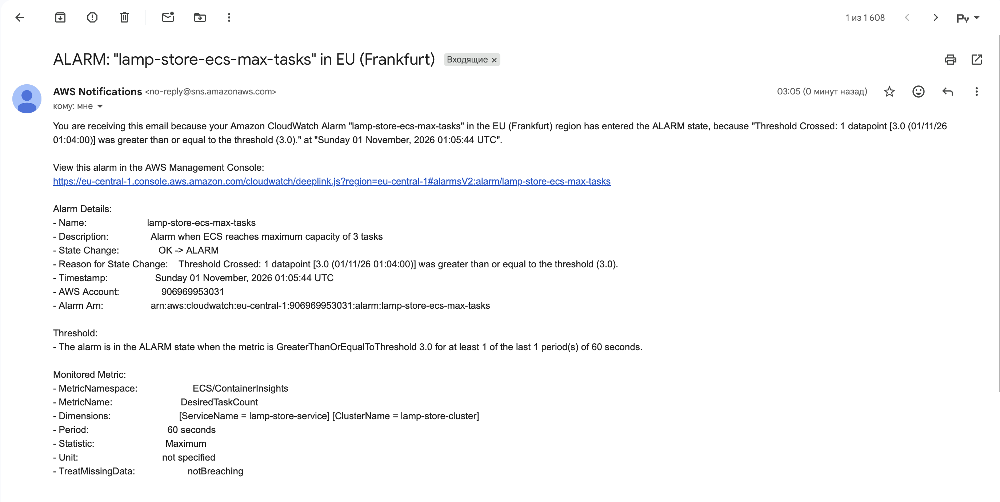
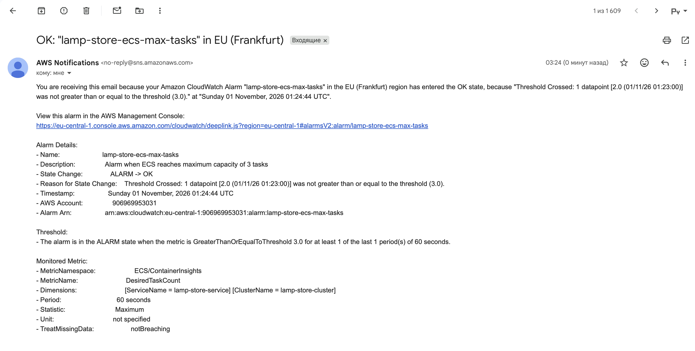

Сповіщення

Для сповіщень використовую Amazon CloudWatch та SNS.
Повідомлення надходять на електронну пошту.

Вибрав умову досягнення максимальної кількості ECS tasks.
Мінімальна кількість становить 1, максимальна — 3.

Коли сервіс досягає 3 tasks, CloudWatch надсилає
повідомлення про перевищення доступної межі масштабування.
Коли кількість tasks зменшується нижче 3, надходить
повідомлення про повернення до нормального стану.

Для доставки повідомлень використовується SNS topic
lamp-store-alerts.

Результати тестування

Для перевірки запустив навантажувальний тест із 40 віртуальними користувачами.

Тест почався о 02:53:52. Стала фаза почалася о 02:56:52.

Під час тесту кількість ECS tasks збільшилася до 3.
CloudWatch перейшов у стан ALARM, після чого на пошту
надійшло повідомлення.

Поріг був досягнутий о 03:04:00, лист надійшов о 03:05:44.
Від початку сталої фази до отримання листа минуло 8 хв 52 секунди.

