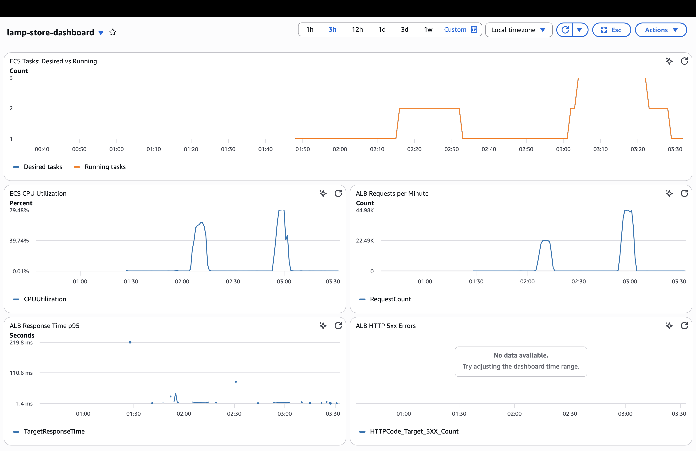

Автоматичне масштабування ECS

Параметри

- Провайдер: AWS
- Сервіс: lamp-store-service
- Тип масштабування: TargetTrackingScaling
- Мінімальна кількість ECS tasks: 1
- Максимальна кількість ECS tasks: 3
- Метрика: ECSServiceAverageCPUUtilization
- Цільове завантаження CPU: 60%
- Scale-out cooldown: 60 секунд
- Scale-in cooldown: 300 секунд

Обґрунтування

Цільове значення CPU 60% обране як компроміс між
продуктивністю сервісу та витратами на ресурси.

Мінімум 1 task забезпечує роботу сервісу навіть за
відсутності навантаження. Максимум 3 tasks обмежує
споживання ресурсів.

Cooldown

Cooldown — період стабілізації після масштабування.

Scale-out cooldown 60 секунд дає системі час врахувати
додану обчислювальну потужність перед наступним
масштабуванням.

Scale-in cooldown 300 секунд уповільнює вилучення
екземплярів і допомагає уникнути передчасного зменшення
потужності.

Якщо встановити cooldown рівним нулю, система зможе
виконувати наступні операції масштабування без очікування
періоду стабілізації. Це може спричиняти надто часті зміни
кількості tasks і нестабільність.

Результати тестування

