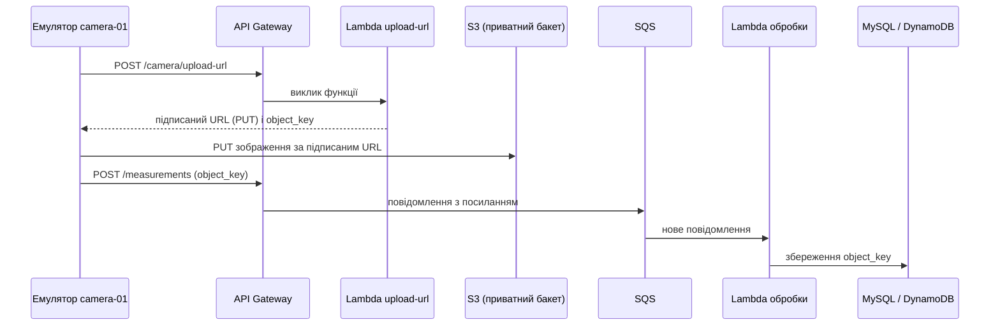

# Бінарні дані в об'єктному сховищі

Загальний принцип роботи

Четвертий тип датчика — камера `camera-01`. Вона з періодом від 10 до 30 секунд (параметр `CAMERA_INTERVAL_MS`, за замовчуванням 15 секунд) надсилає знімок розміром до 1 МБ. Емулятор самостійно формує невелике зображення у форматі PNG.

Зображення не проходить через чергу і не зберігається в базі. Воно завантажується безпосередньо в приватний бакет Amazon S3, а в чергу потрапляє лише звичайне повідомлення з посиланням на об'єкт.

Послідовність дій

1. Емулятор надсилає запит `POST /camera/upload-url` з ключем `x-api-key`, ідентифікатором датчика, типом зображення та розміром.
2. Lambda-функція `lamp-store-lab3-iot-upload-url` перевіряє ключ і дані та створює одноразовий підписаний URL для завантаження (метод PUT). Ключ об'єкта має вигляд `images/<sensor_id>/<час>-<випадковий ідентифікатор>.png`.
3. Емулятор завантажує файл за цим URL напряму в S3.
4. Після успішного завантаження емулятор надсилає звичайне вимірювання `POST /measurements` з типом `camera`, розміром зображення у байтах та полем `object_key`.
5. Приймач перевіряє, що `object_key` має правильний формат і належить цьому датчику, та кладе повідомлення в чергу.
6. Функція обробки зберігає вимірювання в MySQL і DynamoDB разом із ключем об'єкта.
7. Під час запиту історії для камери функція повертає підписані URL для читання, з обмеженим терміном дії.



Чому зображення не передається через чергу і не зберігається в базі

Повідомлення SQS має обмеження розміру 256 КБ, а зображення може займати до 1 МБ. Крім того, великі повідомлення сповільнюють обробку та збільшують вартість викликів функцій.

У базі даних зображення також не варто зберігати. Воно збільшує розмір таблиці, резервних копій і навантаження на базу, яка для цього не призначена. Об'єктне сховище S3 розраховане саме на великі файли, дешеве і добре масштабується. У базі зберігається лише `object_key`, а це короткий рядок.

Що таке підписаний URL

Підписаний URL (presigned URL) — це тимчасове посилання на конкретний об'єкт у S3, яке містить підпис, створений ключами IAM-ролі функції. Він дозволяє виконати одну дію (завантажити або прочитати файл) без окремих облікових даних і лише протягом обмеженого часу. Термін дії задається змінною Terraform `camera_presigned_url_expiration` і за замовчуванням становить 300 секунд.

Бакет повністю закритий для публічного доступу (`block_public_access`), тому без підписаного URL файл отримати неможливо. Ролі функцій мають мінімальні права: функція upload-url може лише записувати об'єкти в `images/`, а функція історії — лише читати їх.

Обмеження розміру: функція перевіряє розмір, який заявляє датчик (не більше 1 МБ), і цей розмір не контролюється на рівні самого підпису.

Перевірка роботи

Після запуску емулятора в журналі з'являються рядки на кшталт `[SENT] camera-01: image ... bytes -> images/camera-01/...`. Файли можна побачити в бакеті:

```bash
aws s3 ls "s3://$(terraform output -raw iot_images_bucket)/images/camera-01/" --region eu-central-1
```

Запит історії камери повертає в кожному записі поля `object_key`, `image_url` та `image_url_expires_in`:

```bash
curl -s "$H?from=$FROM&to=$TO&limit=2"
```

Отриманий `image_url` відкривається в браузері та показує зображення, а після завершення терміну дії посилання перестає працювати.

Результати перевірки

- Емулятор отримує підписаний URL і завантажує зображення в S3 напряму.
- У чергу потрапляє лише повідомлення з `object_key`.
- Історія камери повертає підписані URL для читання з обмеженим терміном дії.
