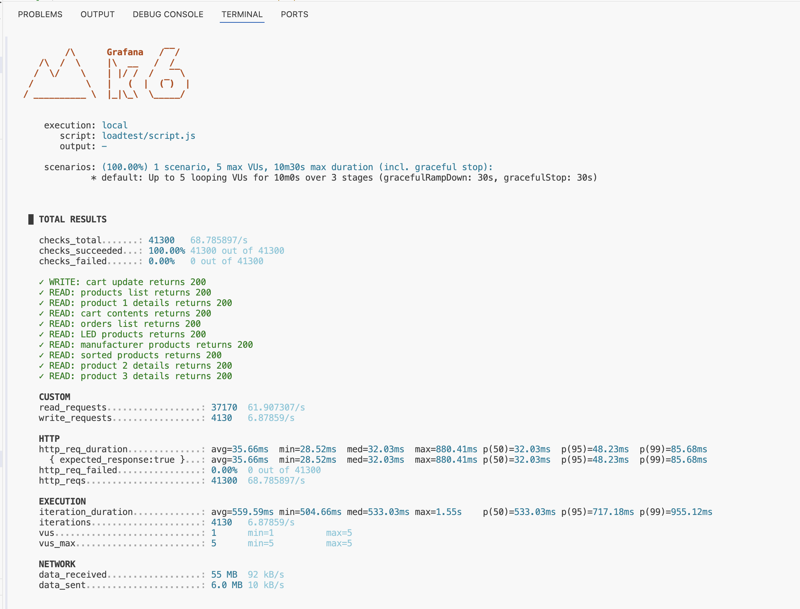
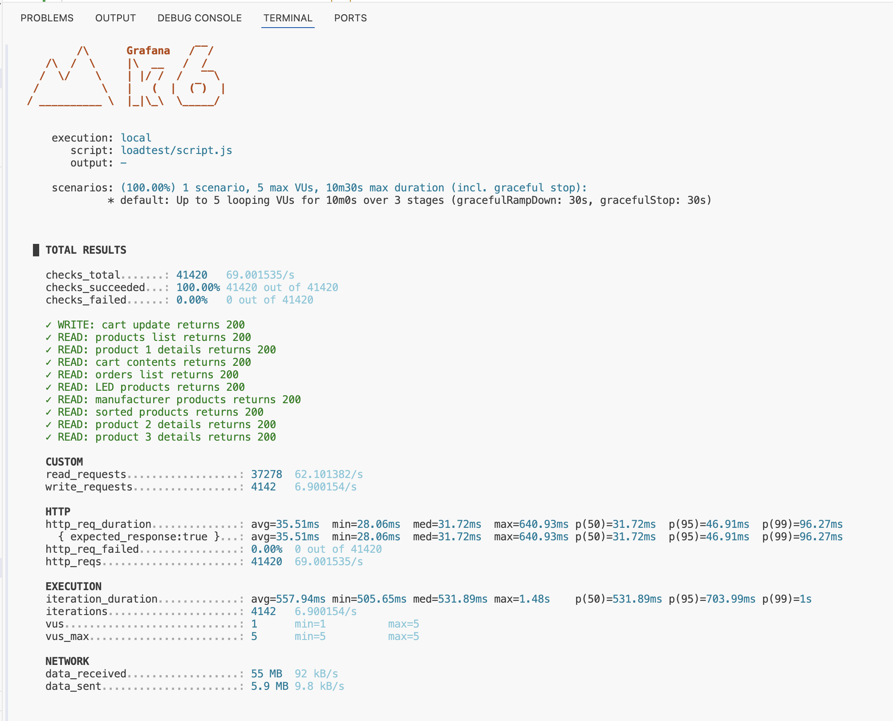

Кешування

Реалізація

Для кешування використано патерн Cache-Aside з in-memory кешем Node.js (`Map`).

Кешується GET-запит до `/api/products`, включно із запитами з параметрами фільтрації та сортування.

Основні параметри:

- TTL: 45 секунд.
- Ключ кешу: URL запиту (`req.originalUrl`).
- Cache hit: повернення збережених даних без повторного звернення до БД.
- Cache miss: отримання даних із MySQL та збереження їх у кеші.
- Cache bypass: параметр `cache=off` дозволяє виконувати запит без використання кешу.
- Після оформлення замовлення кеш очищується, щоб уникнути використання застарілих даних.

Відтворення тестування

Для порівняння продуктивності використовувався один сценарій k6 `loadtest/script.js`.

Тестування проводилося у двох режимах:

- `CACHE_MODE=off` — кешування вимкнене.
- `CACHE_MODE=on` — кешування увімкнене.

Перед запуском тестів необхідно переконатися, що застосунок доступний через Application Load Balancer.

Команди виконуються з кореневої директорії репозиторію.

Отримання адреси Application Load Balancer:

```bash
BASE_URL="http://$(cd lab1/terraform && terraform output -raw alb_dns_name)"
```

Тест без кешування:

```bash
k6 run \
  -e BASE_URL="$BASE_URL" \
  -e VUS=5 \
  -e CACHE_MODE=off \
  --summary-export=loadtest/cache-off.json \
  loadtest/script.js
```

Тест із кешуванням:

```bash
k6 run \
  -e BASE_URL="$BASE_URL" \
  -e VUS=5 \
  -e CACHE_MODE=on \
  --summary-export=loadtest/cache-on.json \
  loadtest/script.js
```

Обидва тести використовують однакову кількість віртуальних користувачів і однакові фази навантаження: 3 хвилини розгону, 5 хвилин стабільного навантаження та 2 хвилини зниження.

Після завершення тестів результати зберігаються у JSON-файлах для подальшого аналізу.

Результати тестування

Для порівняння виконано два навантажувальні тести за допомогою k6 при 5 віртуальних користувачах (VUs) тривалістю 10 хвилин. Сценарій включав 1 операцію запису та 9 операцій читання в кожній ітерації з фазами розгону (3 хвилини), стабільного навантаження (5 хвилин) та зниження (2 хвилини).



Показники продуктивності без використання кешування:

- Загальна кількість запитів: 41 300 (68,79 RPS)
- Рівень помилок: 0%
- Середня затримка: 35,66 мс
- Медіана (p50): 32,03 мс
- Перцентиль p95: 48,23 мс
- Перцентиль p99: 85,68 мс



Показники продуктивності після увімкнення кешування:

- Загальна кількість запитів: 41 420 (69,00 RPS)
- Рівень помилок: 0%
- Середня затримка: 35,51 мс
- Медіана (p50): 31,72 мс
- Перцентиль p95: 46,91 мс
- Перцентиль p99: 96,27 мс

Статистика кешу

За підсумками тестування з увімкненим кешуванням отримано наступні результати:

- Частка успішних попадань (Hit rate): 99,55% (16 495 hits проти 75 misses)
- Запити в обхід кешу (Cache bypasses): 16 520
- Загальна кількість збережених записів у кеші: 4
- Час життя запису (TTL): 45 секунд

Під час проведення тестів ECS працював у конфігурації з однією задачею (1 desired, 1 running), тому всі запити оброблялися єдиним екземпляром застосунку.

Навантаження на базу даних

Оцінка впливу на реляційну базу даних проводилася за допомогою метрик AWS CloudWatch для RDS (середні значення за 10-хвилинні інтервали кожного тесту):

- **Завантаження процесора (CPUUtilization):** зменшилося з 5,64% до 5,36% під час використання кешу.
- **Кількість підключень (DatabaseConnections):** становила 4,2 без кешу та 5,0 у тесті з кешем.
- **Операції читання (ReadIOPS):** залишилися практично на одному рівні — 0,38 без кешу проти 0,37 з кешем.
- **Операції запису (WriteIOPS):** знизилися з 6,96 до 6,68.

Помітного зниження навантаження на базу даних не зафіксовано, оскільки початкова активність на RDS була низькою, а кешування охоплювало лише ендпоінт списку товарів. Решта маршрутів продовжувала звертатися безпосередньо до MySQL.

Висновки

Реалізований механізм кешування продемонстрував високу ефективність обробки повторних запитів (Hit rate 99,55%), забезпечивши віддачу більшості даних без звернення до БД.

Водночас загальний вплив на затримки виявився помірним: покращення p95 склало близько 2,7%, а середнього часу відповіді — 0,4%. Зростання показника p99 у тесті з кешем свідчить про те, що для даного рівня навантаження кеш не дав однозначного виграшу за всіма перцентилями.

Обмеження реалізації

Локальний in-memory кеш існує виключно в межах одного процесу Node.js. При масштабуванні ECS на декілька задач кожна з них матиме власний ізольований кеш, що призведе до розсинхронізації даних між інстансами.

Для повноцінного production-середовища з кількома ECS-задачами необхідно використовувати централізоване сховище (наприклад, Redis або Memcached). Встановлений TTL також залишає вікно в 45 секунд, протягом якого користувачі можуть отримувати застарілі дані, якщо вони не підлягають примусовій інвалідації.